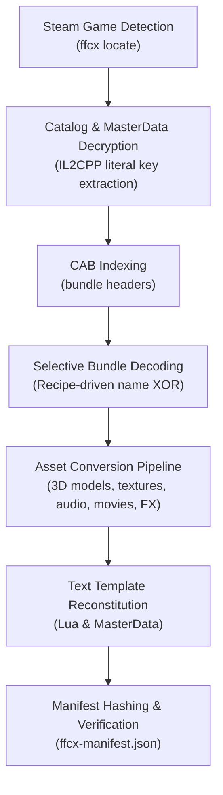

# Developer Guide & Architecture

This guide covers the technical architecture, development workflows, extraction pipeline, release process, and infrastructure for **FF7 Forever Crisis**.

> [!IMPORTANT]
> **No Game Assets in Source Control**
> Never commit files extracted from the game (models, textures, audio, video, animations, Lua scripts, dialogue, or decrypted master data), screenshots showing game content, or encryption keys. CI executes `npm run scan` on all PRs to enforce this policy.

---

## Repository Layout

```
forever-crisis/
├── app/              # Web application (Vite + TypeScript + three.js)
│   └── public/icons/ # Site icons (drawn by release-tools/make_installer_art.py --icons; original art)
├── api/              # Azure Functions (SWA managed): /api/version, /api/compat, /api/saves, /api/telemetry
├── swa/              # staticwebapp.config.json (routing, auth, security headers)
├── extractor/        # ffcx: Python extractor + local server (PyInstaller -> ffcx.exe, ffcx-server.exe)
│   ├── ffcx/         # Game discovery, catalog/MasterData decryption, bundle decoding, pipeline, text, server
│   ├── vendor/       # Explorer converters (copied by release-tools/sync_vendor.py, paths from FFCX_* env)
│   └── data.lock.json# Published data pack pointer (filename + SHA-256 + download URL)
├── installer/        # install.ps1 (irm | iex bootstrap: PS 5.1 -> portable PS 7 + PwshSpectreConsole UI)
│   └── art/          # Procedural materia animations drawn by make_installer_art.py
├── infra/            # main.bicep: Azure Static Web App (Free), Table Storage, Key Vault, GitHub OIDC
├── release-tools/    # Maintainer utilities requiring local extraction (recipes, templates, decode lists)
├── scripts/          # Automation: export-public, fetch-tools, finish-dist, scan, stage-release
├── tests/            # Unit tests (templates, data lock) and end-to-end checks (CSP headers, service worker)
└── .github/workflows # CI (build + tests + scan), release, deploy-swa, preview-swa, publish-data
```

---

## How Extraction Works

The extraction engine (`extractor/ffcx`) runs as a multi-stage pipeline that converts the game's proprietary Unity and Octo data formats into open web standards:



1. **Game Discovery (`ffcx locate`)**:
   Reads the Steam install path from the Windows Registry and parses `libraryfolders.vdf`. It verifies `FF7EC.exe`, IL2CPP metadata, `octo/pdb/**/octocacheevai`, and `octo/v1`.
2. **Catalog & MasterData Decryption**:
   The Octo catalog is AES-decrypted using a key discovered among the player's own IL2CPP string literals, then parsed against `Database.proto`. The MasterData decryption key is extracted through the same mechanism.
   *Note: The CRI encryption key for audio and video (`0x11DA4DE45ADE` in `extractor/ffcx/convert.py`) is public from [vgmstream's key repository](https://github.com/vgmstream/vgmstream/blob/master/src/meta/hca_keys.h).*
3. **CAB Indexing**:
   Header bytes of all bundles are decoded to build a fast internal CAB index.
4. **Targeted Bundle Decoding**:
   Only bundles and resources specified in `recipe.json` are decoded (using name-derived XOR) into a local staging directory.
5. **Asset Converters**:
   - **3D Models**: Converted with `unity_gltf.py` v5 (includes battle stages with baked lightmaps, emissive materials, and props).
   - **Textures**: Exported with UnityPy to PNG (including stage normal and occlusion maps).
   - **Audio**: vgmstream converts CRI HCA/ADX streams to FLAC with loop points preserved.
   - **Video / Cutscenes**: WannaCRI converts USM movies to VP9 video + FLAC audio in MKV containers.
   - **Animations**: Processed with `convert_anims.py --scope all`.
   - **Battle Effects**: Particle systems, meshes, stage ambience, and bone attach points converted via `convert_effects.py`.
   - **Lighting**: Fog parameters, ambient light, directional sun vectors, and post-processing profiles extracted with `extract_lighting.py`.
6. **Text & Script Generation**:
   Dialogue, menu texts, and quest templates are hydrated from decrypted MasterData and Lua scripts. Any strings missing due to upstream Steam game updates fallback to row IDs (see [KNOWN-GAPS.md](KNOWN-GAPS.md)).
7. **Verification**:
   Every extracted asset is hashed into `ffcx-manifest.json` and verified against release reference hashes.

### Resumability & Early Art Extraction
- Before full extraction begins, `ffcx art --game <dir> --out <install>` decodes 16 lightweight bundles (story logos and nine backdrops) into `<install>\.ffcx\art` to render branded UI during installation.
- Progress is emitted as JSON Lines (`{"event":"phase"|"progress"|"warn"|"error"|"done", ...}`).
- Each phase records completion state in `.ffcx/done/*.txt` stamped with reference hashes. Re-running the installer only re-processes modified assets.

---

## Local Development Setup

### 1. Prerequisites
- **Node.js**: v20 or later
- **Python**: 3.10+ (64-bit)
- **PowerShell**: 7.4+
- A valid local extraction of game assets (created via the installer)

### 2. Frontend Development (`app/`)

Clone the repo, install dependencies, and run Vite:

```bash
npm ci
npm run build          # Builds app and dist without needing game assets
npm test               # Runs unit tests and API tests
npm run scan           # Verifies no confidential data or game assets exist
```

To run the web application with your extracted assets:

```bash
# Point FFC_ASSETS to your extracted folder (e.g., C:/Games/FF7-Forever-Crisis)
$env:FFC_ASSETS = "C:/Games/FF7-Forever-Crisis"
npm --prefix app run dev
```

### 3. API & Emulator Development (`api/`)

The API runs on Azure Functions with Azure Table Storage:

```powershell
npm install
npm run azurite                                      # Starts Table Storage emulator
Copy-Item api\local.settings.sample.json api\local.settings.json
npm run build:app
npm run swa                                          # Runs Azure SWA CLI (http://localhost:4280)
```

---

## Building a Release (Maintainer Workflow)

Building a release requires the maintainer's working tree, local extraction, converters, and game directory. Paths are configured via environment variables or `release-tools/paths.local.json` (see `release-tools/paths.py`).

```powershell
# 1. Prepare environment and vendor sync
py -3.10 -m venv .venv
.venv\Scripts\pip install -r extractor\requirements.txt pyinstaller pygltflib
.venv\Scripts\python release-tools\sync_vendor.py

# 2. Recipe and template generation
.venv\Scripts\python release-tools\make_recipe.py --no-hash
.venv\Scripts\python release-tools\dehydrate.py

# 3. Recording run (trace extraction on local files)
..\.venv\Scripts\python -m ffcx extract --archive <extraction> --client <game_folder> --out <output_dir> --trace
.venv\Scripts\python release-tools\record.py <output_dir>

# 4. Partial re-recording (after converter adjustments)
..\.venv\Scripts\python -m ffcx extract --archive <extraction> --client <game_folder> --out <output_dir> --trace --only models,effects,lighting
.venv\Scripts\python release-tools\record.py <output_dir> --partial

# 5. Pack data and tools
.venv\Scripts\python release-tools\pack_data.py
pwsh release-tools/publish-data.ps1 -Account <azure_storage_account>
pwsh scripts/fetch-tools.ps1
.venv\Scripts\python release-tools\make_installer_art.py
```

### Publishing Steps
1. Commit changes, tag `vX.Y.Z`, and push to GitHub.
2. `.github/workflows/release.yml` triggers automatically:
   - Compiles `ffcx.exe` and `ffcx-server.exe` with PyInstaller.
   - Bundles the frontend explorer (`app-*.zip`) and PowerShell modules (`pwsh-modules-*.zip`).
   - Generates `install.ps1`, `release.json`, and `SHA256SUMS.txt`.
3. Update `api/release-feed.json` with the new version information.

---

## Testing the Installer Locally

You can test the bootstrap script and release bundles in an isolated local environment:

```powershell
# Stage release artifacts and host on a local HTTP server
pwsh scripts/stage-release.ps1 -Out .\release-base -Site http://127.0.0.1:4280 -Mirror
python -m http.server 8765 -d .\release-base

# In a standard Windows PowerShell 5.1 window:
$env:FFC_BASE = 'http://127.0.0.1:8765'
$env:FFC_INSTALL_DIR = "$env:TEMP\ffc-install"
$env:FFC_PWSH_ZIP = 'http://127.0.0.1:8765/PowerShell-7.6.7-win-x64.zip'
irm $env:FFC_BASE/install.ps1 | iex
```

---

## Infrastructure & Azure Deployment

Infrastructure is defined in `infra/main.bicep`:
- **Azure Static Web App (Free Tier)**: Serves the SPA frontend and hosts managed Azure Functions (`/api/*`).
- **Azure Table Storage**: Manages cloud save slots and opt-in aggregated telemetry events.
- **Azure Key Vault**: Stores secure deployment secrets.
- **GitHub OIDC Federation**: Workflows authenticate without long-lived stored Azure secrets.

Deployment pipelines:
- `.github/workflows/deploy-swa.yml`: Triggers on push to `main`.
- `.github/workflows/preview-swa.yml`: Creates staging environments for open pull requests.

For detailed configuration instructions and variable mappings, see [infra/README.md](../infra/README.md).
